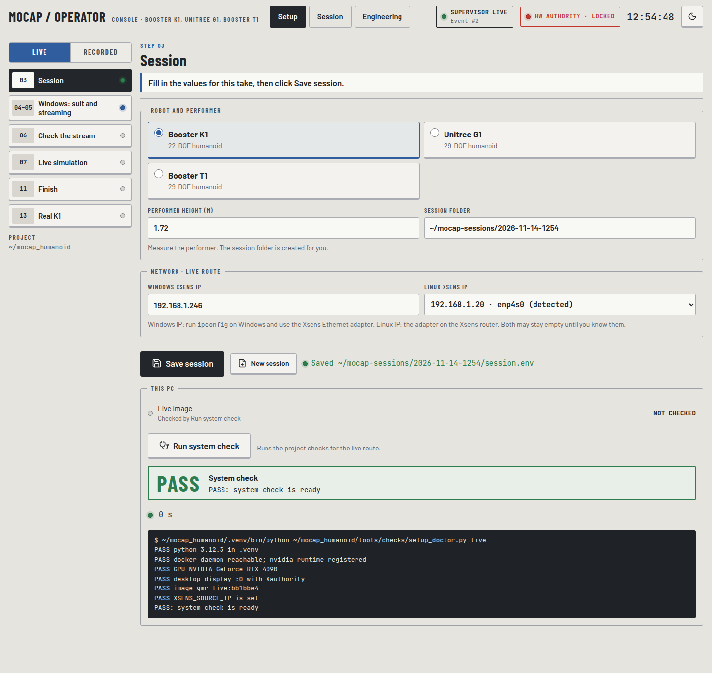
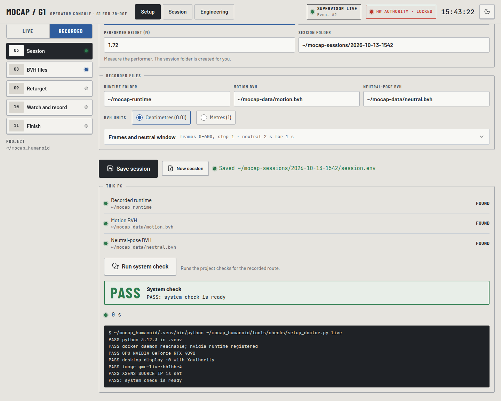
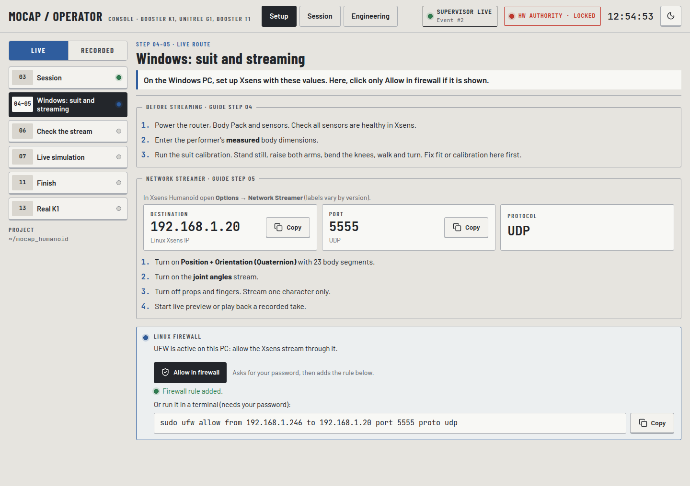
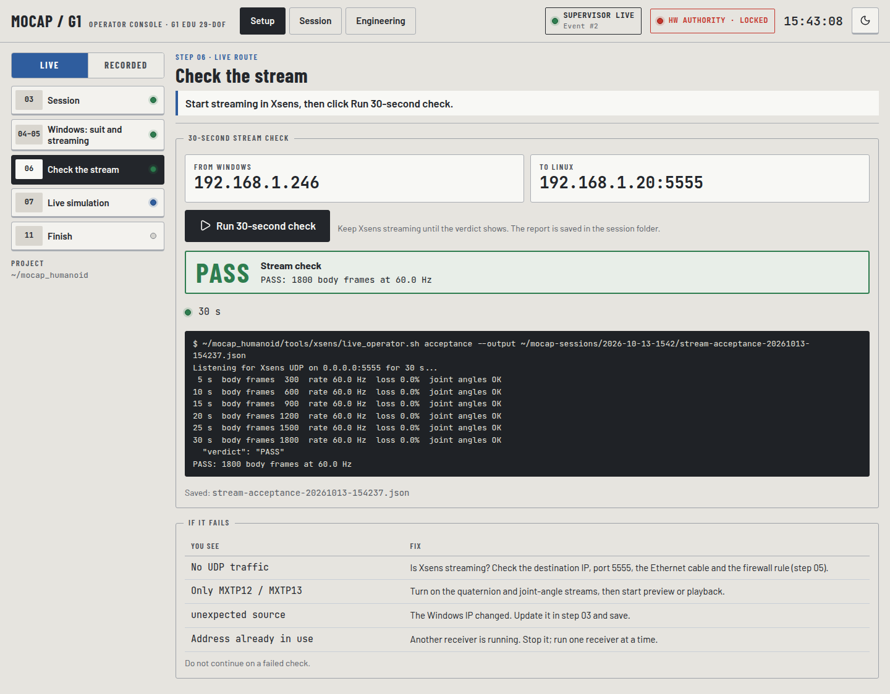
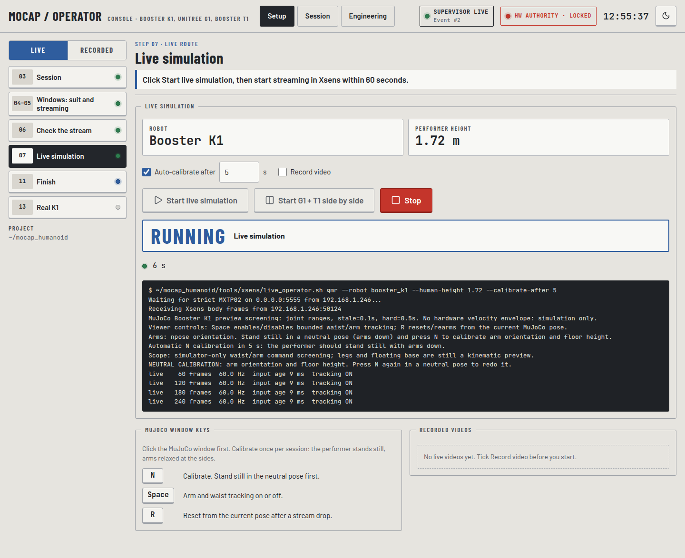
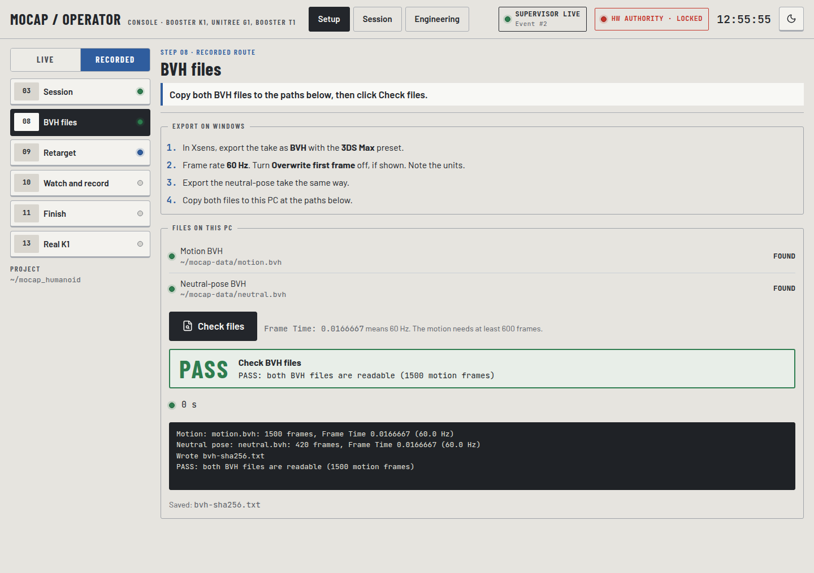
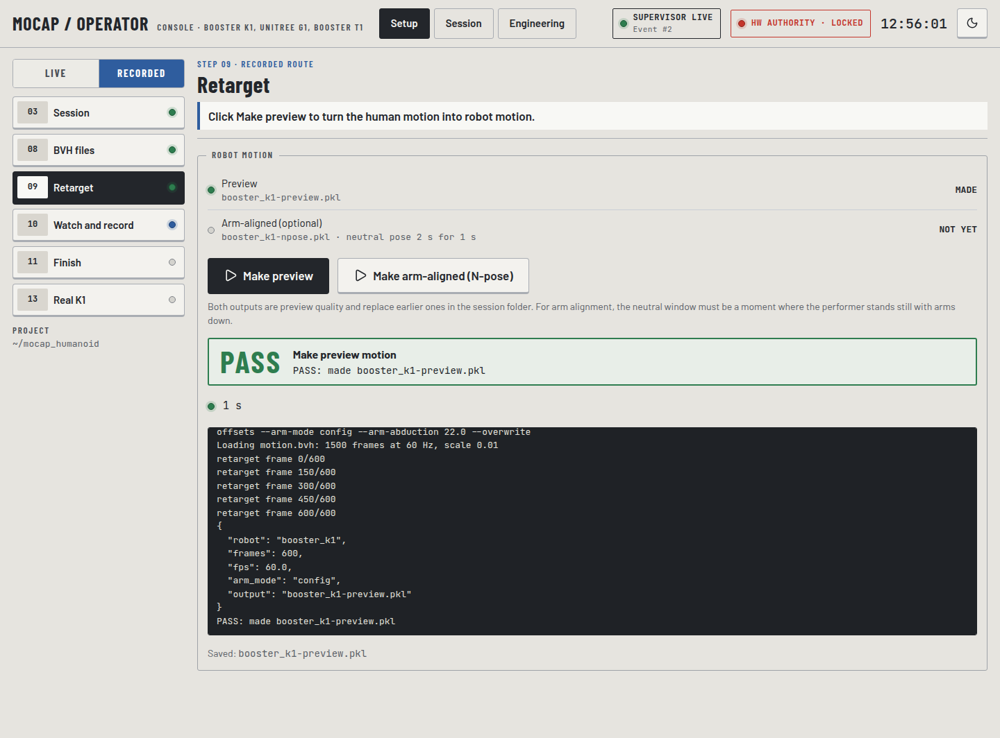
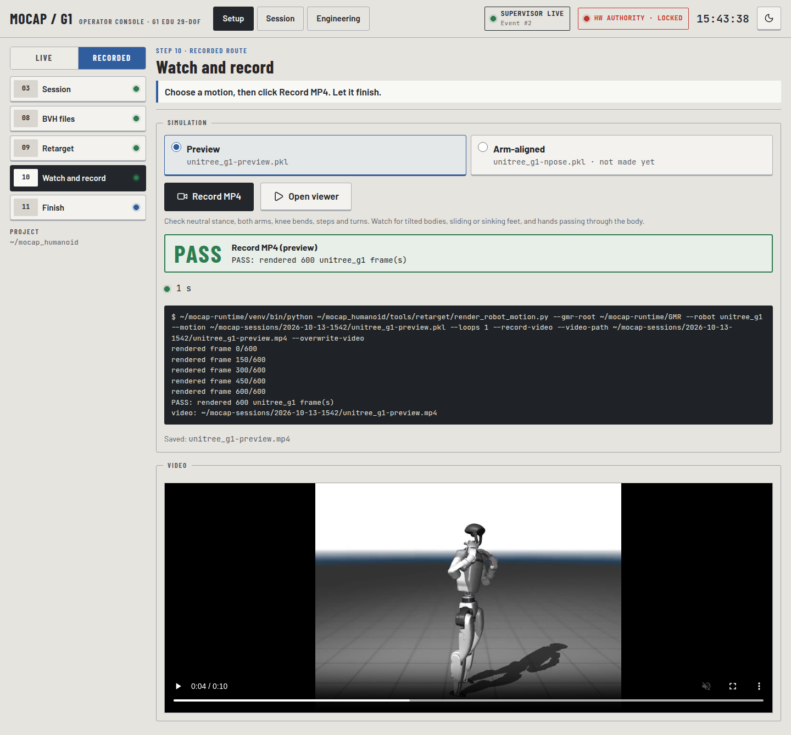
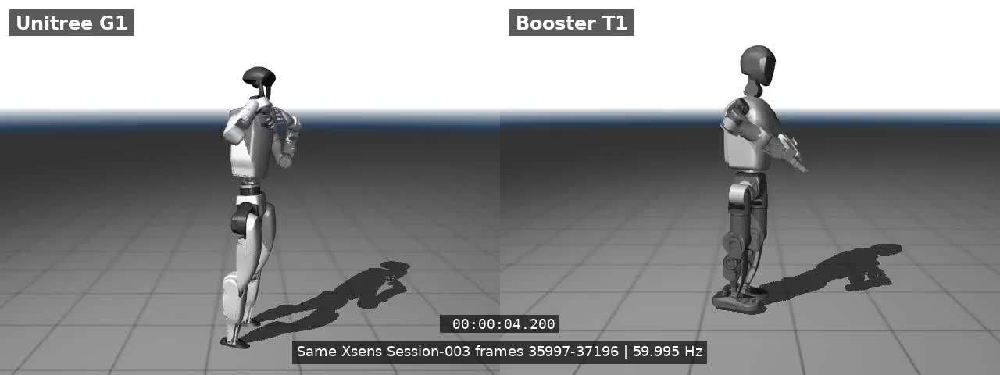
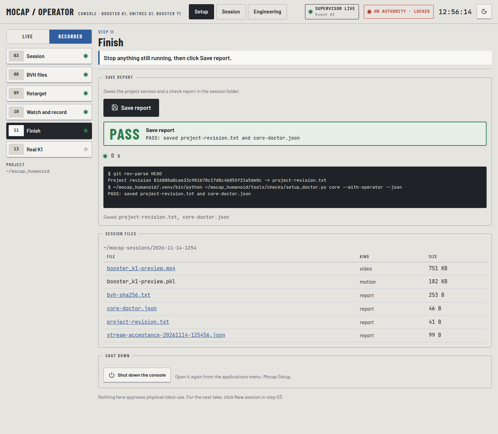

# Xsens mocap → humanoid simulation

Step-by-step setup guide · reviewed against this checkout on 2026-10-13. Live suit → simulation comes first; recorded export is the second route.

Open [the interactive version](engineer-setup.html) to follow one step at a time with copy buttons and a progress tracker. This Markdown file is its source. Details, edge cases and the full troubleshooting table are in [the engineering reference](engineer-reference.md).

## 01 · Before you start

**Goal:** your live Xsens suit movement drives a simulated Unitree G1 or Booster T1 in MuJoCo. A physical robot is optional and comes later; this guide does not use one.

Pick a route:

| Route | Robots | Use it when |
| --- | --- | --- |
| **Live** · Xsens suit → UDP stream → Linux → MuJoCo | Unitree G1 or Booster T1 | Normal use: the robot follows the performer in real time |
| **Recorded** · Windows BVH export → Linux retarget → MuJoCo | Unitree G1 or Booster T1 | Repeatable reviews, comparisons and saved videos |

You need:

- **Windows capture PC** with Xsens Humanoid (MVN), a valid license, and the MVN Link suit, Body Pack and router.
- **Ubuntu 24.04 or 22.04 PC** with a local desktop (not SSH) and an NVIDIA GPU for the live route.
- **An Ethernet cable** from each PC to the Xsens router. Keep Internet on Wi-Fi.

**Only one PC (Windows)?** The live and recorded simulation also install natively on the Xsens Windows PC with one click: see [Windows: Xsens suit → MuJoCo on one PC](windows-setup.md). This guide covers the two-PC Ubuntu setup.

**How this guide works:** you use the terminal once, to install (step 02). Every later Linux step is done by clicking in the **Setup console**, a page in your browser on the Ubuntu PC. On Windows you work in Xsens Humanoid itself. The few remaining terminal commands are marked, and the console shows them ready to copy.

Simulation shows motion only. It does not prove balance or approve robot hardware. Real-robot control is a separate, later stage (see step 11).

## 02 · Install on the Ubuntu PC

This is the only step that needs the terminal. The live route needs Docker and NVIDIA support, so install those first (the section below), then run the installer.

Open a terminal and paste this one line. It installs Git, downloads the project and starts the setup questions:

```bash clone
sudo apt-get update && sudo apt-get install -y git && git clone https://github.com/prateek-ari/mocap-humanoid-release.git && cd mocap-humanoid-release && bash tools/setup/install.sh
```

Already have the project? Run this from its folder instead:

```bash
bash tools/setup/install.sh
```

The installer asks short questions. Press **Enter** to accept each default:

| Question | Default | Notes |
| --- | --- | --- |
| What to set up | 1 · Live | Builds the live image for both robots. Choose 2 for recorded |
| Also build ROS 2 | No | Live only, optional |
| Which robot / GMR runtime folder | Unitree G1, `~/mocap-runtime` | Recorded only. Large download, kept outside the project folder |
| Install missing Ubuntu packages | Yes | May ask for your password once |
| Open the Setup console now | Yes | Opens it in your browser |

It installs everything, runs the project checks and ends with `PASS`. Image builds and the recorded runtime download can take a while; let them finish. If a step fails, fix the printed cause and run the same command again: finished parts are reused.

The installer also adds **Mocap Setup** to your applications menu. From now on, open the Setup console from there: it starts the console if needed and opens `http://127.0.0.1:8784/` in your browser. Open it from the desktop of this PC, not over SSH, so the simulation windows can appear.

### Docker and NVIDIA (live route)

**Easiest:** run `bash install-ubuntu.sh` from the project folder instead of the commands above. It checks the NVIDIA driver, Docker, the NVIDIA Container Toolkit and the project, and installs only what is missing (restart and run it again if it installs the driver). `bash install-ubuntu.sh --check` only reports.

To install them by hand instead, do this before choosing **1 · Live**, using the official instructions:

1. A working NVIDIA driver: `nvidia-smi` lists your GPU.
2. [Docker Engine for Ubuntu](https://docs.docker.com/engine/install/ubuntu/). Then let your user run Docker without sudo, and log out and in again.
3. [NVIDIA Container Toolkit](https://docs.nvidia.com/datacenter/cloud-native/container-toolkit/latest/install-guide.html), then register it with Docker:

```bash host
sudo nvidia-ctk runtime configure --runtime=docker && sudo systemctl reload docker
```

Check that `docker info` lists the `nvidia` runtime, then run the installer and choose **1 · Live**. Install the recorded route too (run the installer again and choose **2**) if you want to replay recordings or review saved takes.

**Done when:** the installer prints `PASS` and the Setup console is open in your browser.

## 03 · Enter your session values

Each take or test gets its own session folder. In the Setup console, pick **Live** or **Recorded** at the top left, then open **03 Session**:

1. Choose the robot: **Unitree G1** or **Booster T1**.
2. Enter the **measured** performer height in metres.
3. Keep the suggested session folder (a new dated folder under `~/mocap-sessions`), or type another one inside your home folder.
4. **Live:** type the **Windows Xsens IP** (run `ipconfig` on Windows and read the Xsens Ethernet adapter), then choose the **Linux Xsens IP**: the address marked *(detected)* is the adapter on the Xsens router. Both can stay empty until you know them.
5. **Recorded:** check the runtime folder and the two BVH paths (you copy the files there in step 08) and choose the BVH units (centimetres is the Xsens default). Open **Frames and neutral window** only if your take needs other frames.
6. Click **Save session**. The console shows `Saved ~/mocap-sessions/…/session.env`.
7. Click **Run system check** and wait for **PASS**. If it shows FAIL, read the lines marked `FAIL` and see step 12.



On the recorded route the network fields are replaced by the runtime folder, the BVH files and their units:



A field with a problem turns red with the reason underneath; fix it and save again. For the next take, click **New session**: it fills in your previous answers and a fresh folder.

**Done when:** the console shows `Saved …/session.env` and the system check says **PASS**.

## 04 · Fit and calibrate the suit (Windows)

On the **licensed Windows capture PC**, in Xsens Humanoid (the Setup console's **04–05 Windows** step lists the same checks):

1. Install Xsens Humanoid and License Manager from [Xsens software and documentation](https://www.xsens.com/support/software-documentation). Activate the license on this physical PC only; do not use a VM, WSL or a second PC.
2. Power the router, Body Pack and sensors. Fit each sensor where the hardware manual shows. Check that all sensors are healthy in Xsens.
3. Create the performer and enter their **measured** body dimensions.
4. Run the Xsens suit calibration. Check it: stand still, raise both arms, bend the knees, walk and turn. If the Xsens skeleton looks wrong, fix fit or calibration here first.
5. Record a short **neutral-pose take** (stand still, arms down) and a **10–20 second motion take**. Play both back in Xsens.

> SCREENSHOT: W02 · Xsens sensor status and actor dimensions. Show healthy kit sensors and measured dimensions without performer identity.

> SCREENSHOT: W03 · Calibration result and neutral source pose. Show accepted calibration and the reviewed neutral interval.

More detail: [Windows setup](windows-xsens-humanoid-setup.md).

**Done when:** calibration is accepted and the playback looks right in Xsens.

## 05 · Connect Xsens streaming

Live route. Both PCs must be on the Xsens router by Ethernet, and step 03 must contain both IP addresses.

In the Setup console, open **04–05 Windows: suit and streaming**. It shows the exact values to type on Windows, each with a **Copy** button:



On **Windows**, in Xsens Humanoid open **Options → Network Streamer** (labels vary by version):

1. Destination: the **Destination** IP shown in the console (your Linux Xsens IP). Port: **5555**, UDP.
2. Turn on **Position + Orientation (Quaternion)** with 23 body segments, and the **joint angles** stream.
3. Turn off props and fingers. Stream one character only.
4. Start live preview or play back a recorded take.

> SCREENSHOT: W04 · Network Streamer settings. Show Linux destination, UDP 5555, body quaternion and joint-angle streams, and props/fingers disabled.

**Linux firewall** (only if UFW is active): the console shows the exact command under **Linux firewall**. Click its **Copy** button, paste it into a terminal and enter your password. It looks like this:

```bash host
sudo ufw allow from 192.168.1.246 to 192.168.1.20 port 5555 proto udp
```

The console cannot run this for you because it needs administrator rights. If both routers use the same subnet, see [overlapping networks](engineer-reference.md#overlapping-wi-fi-and-xsens-subnets).

**Done when:** Xsens is streaming to the destination shown in the console on port 5555.

## 06 · Check the real stream

With Xsens still streaming, open **06 Check the stream** and click **Run 30-second check**. Keep streaming until the verdict appears.



**PASS:** the console shows a green **PASS** with the frame count and rate, and saves the report (`stream-acceptance-….json`) in your session folder.

**FAIL:** read the reason in the verdict and the log. The **If it fails** table under it lists the usual fixes: `MXTP12`/`MXTP13` only means motion streams are switched off or Xsens is idle (step 05); `unexpected source` means the Windows IP changed, so update it in step 03 and save. More fixes are in step 12.

**Done when:** the stream check shows **PASS**. Do not continue on a failed check.

## 07 · Run the live simulation

Open **07 Live simulation**. It shows the robot and height from your session.

1. Optional: tick **Auto-calibrate after** (for example 5 s) if the performer works alone, and **Record video** to save an MP4.
2. Click **Start live simulation**. A MuJoCo window opens on this PC.
3. Start or resume Xsens streaming within 60 seconds. The log shows `Receiving Xsens body frames`.
4. **Calibrate once per session:** the performer stands still, arms relaxed at the sides, and someone clicks the MuJoCo window and presses **N** (or waits for the auto-calibration). This puts the robot's feet on the floor (and, for the T1, calibrates arm orientation).
5. Click **Stop** when you are done. A recorded video is copied into the session folder and listed under **Recorded videos**, where you can play it in the browser.



To show **G1 and T1 side by side in one window**, stop the single-robot viewer
first, then run these commands from the repository root:

```bash
source session.env
bash docker/gmr-live/run-compare.sh --calibrate-after 5
```

Keep Windows streaming and stand still with arms down for the first five
seconds. Both robots use the same received frame and calibrate automatically.
The comparison currently starts from the terminal, rather than the Setup
console's single-robot button. See [what changed and why](live-xsens-commissioning-2026-10-14.md)
and the [offline block diagram](live-xsens-g1-t1-diagram.html).

Keys in the MuJoCo window (click it first):

- **Space** turns arm and waist tracking on or off.
- **R** resets from the current pose after a stream drop.
- **N** recalibrates; stand still in the neutral pose first.

Check neutral stance, both arms, knee bends, steps and turns against the performer. The arms are deliberately held a few degrees away from the body (10° on the G1, 22° on the T1) so hanging hands clear the robot's wider hips.

No suit yet? Replay a real recording into the same viewer: see [Testing without an Xsens suit](testing-without-suit.md#replay-a-real-recording).

**Done when:** the robot follows the performer and you have noted anything that looks wrong.

## 08 · Export BVH and copy it to Linux

On **Windows**, in Xsens:

1. Open the take and export it as **BVH** with the **3DS Max** preset. Other presets are not supported.
2. Set the frame rate to **60 Hz** and turn **Overwrite first frame** off, if shown. Note the units (centimetres is the default).
3. Export the neutral-pose take the same way.
4. Copy both files to the Linux PC, to the paths in the console's **08 BVH files** step (by default `~/mocap-data/motion.bvh` and `~/mocap-data/neutral.bvh`), for example with a USB drive and the Files app. Keep the original `.mvn` files on Windows.

> SCREENSHOT: W05 · BVH export dialog. Show 3DS Max preset, units, sample rate and Overwrite first frame setting.

In the Setup console, open **08 BVH files**. Both files should show **FOUND**. Click **Check files**.



The check reads each file's frame count and frame time (`0.0166667` means 60 Hz) and saves their checksums as `bvh-sha256.txt` in the session folder. It fails if the motion take has fewer frames than the end frame from step 03 (600 by default); then lower the end frame under **Frames and neutral window** in step 03 and save.

**Done when:** **Check files** shows **PASS**.

## 09 · Turn the motion into robot motion

Open **09 Retarget** and click **Make preview**. This retargets the human motion onto your selected robot and saves `<robot>-preview.pkl` in the session folder. Running it again replaces the earlier file.



**Optional: better arm alignment.** In Xsens playback, find a moment where the performer stands still with arms down. If it is not at 2.0 s for 1.0 s, change **Neutral start** and **Neutral length** in step 03 and save. Then click **Make arm-aligned (N-pose)**; it saves `<robot>-npose.pkl` and an arm calibration file.

Both outputs are **preview quality**. Full calibrated offsets, arm/body clearance correction and G1/T1 comparisons are in [the reference](engineer-reference.md#recorded-route-advanced).

**Done when:** the verdict says `PASS: made <robot>-preview.pkl`.

## 10 · Watch and record the simulation

Open **10 Watch and record** and choose **Preview** or **Arm-aligned**.

- **Open viewer** plays the motion once in a MuJoCo window on this PC.
- **Record MP4** renders it to `<robot>-preview.mp4` (or `-npose.mp4`) in the session folder. Let it finish; do not close the window early. The video then plays right in the console.





**Check:** neutral stance, both arms raising the right way, knee bends, steps and turns. Watch for tilted bodies, sliding or sinking feet, and hands passing through the body.

**Done when:** the verdict says `PASS: rendered …` and the video plays in the console.

## 11 · Stop and save

1. Stop anything still running: click **Stop** on the running job (a strip at the top of every step shows it). Let video recordings finish first.
2. Stop Network Streamer on Windows and save the take.
3. Open **11 Finish** and click **Save report**. It saves the project version (`project-revision.txt`) and a check report (`core-doctor.json`) in the session folder and lists every file of the session, with links to the reports and videos.



For the next take, go back to step 03 and click **New session**. Closing the browser tab leaves the console running in the background, ready for the menu entry; to stop it, run `bash tools/setup/open_console.sh --stop` in the project folder.

Nothing here approves physical robot use. Connecting a real robot is optional, later, and not covered by this guide; the live viewer's `--g1-hardware-envelope` previews the speed-limited commands a real G1 would receive. Booster hardware is not supported by this project.

## 12 · Fix common problems

| Problem | Fix |
| --- | --- |
| The **Mocap Setup** menu entry does nothing | Open a terminal in the project folder and run `bash tools/setup/open_console.sh` to see the error. Its log is `~/.local/state/mocap-g1/setup-console.log`. |
| `port 8784 is used by another program` | Another program uses the port. Stop it, or start with `MOCAP_SETUP_PORT=8785 bash tools/setup/open_console.sh`. |
| `externally-managed-environment` (installer) | Do not use system pip or `sudo pip`. Rerun `bash tools/setup/install.sh`. |
| `No module named pip` (installer) | Run `.venv/bin/python -m ensurepip --upgrade`, then rerun the installer. |
| Buttons stay greyed out | Save a session first (step 03), and wait for the running job to finish or click **Stop**. |
| `No desktop display` | The console was started without a desktop, for example over SSH. Open it from the **Mocap Setup** menu entry on this PC's desktop: that restarts it with the display. If a job is running, stop it first. |
| `A live viewer from an earlier run is still running` | Click **Stop leftover viewer**, then try again. |
| `Another program is using UDP port 5555` | A stream check or viewer started from a terminal is still running. Stop it with Ctrl+C; run one receiver at a time. |
| No UDP traffic | Is Xsens streaming? Check the destination IP and port 5555, the Ethernet cable and the firewall command (step 05). |
| Only `MXTP12`/`MXTP13` | Turn on the quaternion and joint-angle streams and start preview or playback. |
| `unexpected source` | The Windows IP changed. Update it in step 03 and click **Save session**. |
| `Recorded runtime not found` | Run the installer again and choose **2 · Recorded**. |
| Docker `permission denied` | Your user is not in the docker group yet. Add it, then log out and in. |
| Docker cannot use the GPU | Register the NVIDIA runtime (step 02, live route). |
| Robot too small or too big | Check the BVH units and the measured height in step 03. |
| Arms move the wrong way | Recheck the suit calibration (step 04). Live: press N in a neutral pose. Recorded: try **Make arm-aligned** in step 09. |
| Feet sink into or float above the floor (live) | Press N in the MuJoCo window while the performer stands still. |
| Only a `.partial` file | The run was interrupted. Run it again. |
| Robot shakes or lags only with `--g1-hardware-envelope` | Expected: that mode applies real-robot speed limits. It is not used by the Setup console. |

Prefer the terminal, or working over SSH without a desktop? Every step has a command-line equivalent: `bash tools/setup/new_session.sh` writes the same `session.env`, and the other commands are listed under [terminal equivalents](engineer-reference.md#terminal-equivalents-of-the-setup-console) in the engineering reference. Everything else, including Docker/NVIDIA details, the ROS 2 topics check, full calibration and what to send when asking for help, is there too.
