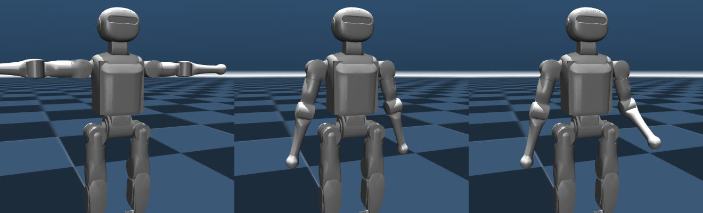

# Booster K1 hardware test guide (bring-up runbook)

This guide takes a new Booster K1 EDU from "just delivered" to the first arm replay, one small
step at a time. Each step has a script, `tools/control/k1_commission.py`, that moves the robot as
little as possible, checks the result, and saves the evidence. The last step writes the
**acceptance record**, the file that unlocks real replay in `tools/control/k1_arm_bridge.py`.

**Nothing in this code has run on a real K1 yet.** The steps are built so that the first real runs
are safe: the robot hangs in a hoist, every motion is small and slow, and every step stops and
releases the arms when something looks wrong.

**The easiest way to run the steps is the test window** (a GUI with buttons; see
[The test window](#the-test-window)). It runs the same script, so everything in this guide
applies to it.

## Stop rules (read first)

- The robot hangs in a **hoist** for every step. The hoist must take the robot's weight if it
  falls.
- A **second person holds the Booster remote** during every step that moves the robot and watches
  the arms. **LT+BACK puts the robot in damping mode.** Use it at the first unexpected motion, then
  press Ctrl-C in the terminal.
- Nobody and nothing within reach of the arms.
- The software release can be slow. The SDK sends one request at a time, so a release can wait
  behind another request: timeouts of about 9 s were seen with no robot answering. If the tool prints
  `Release NOT confirmed`, **stop the robot with the remote at once** (LT+BACK) and keep it on the
  hoist.
- Run one motion program at a time. The tools refuse a second one on the same PC, but they cannot
  see another PC: make sure no other computer sends commands to the robot.
- A step that ends in FAIL is information, not a reason to push on. Read the "What to check" line,
  fix the cause, and run the step again. Send the session folder to the developers when unsure.

## What you need

- The robot, its remote, a hoist, two people.
- An **Ubuntu 22.04 or 24.04 PC** (x86_64 or ARM) with a screen: the mirror (step 3) opens a 3D
  window. The Booster SDK has no Windows version, so the Windows desktop app cannot drive the robot.
- An Ethernet cable from the PC to the robot.
- A protractor or goniometer (for step 4), and a phone to film the motion steps.
- Run every command from the project folder (the checkout of this repository).

## Terms

| Term | Meaning |
| --- | --- |
| rad | the unit of joint angles: 1 rad = 57.3°, 0.1 rad ≈ 6° |
| hoist | a frame and strap that holds the robot up and catches it if it falls |
| damping mode | Booster's safe mode: the joints go soft and only resist fast motion (remote LT+BACK) |
| prepare / walking mode | Booster's standing modes, set with the remote; in walking mode Booster balances the robot |
| takeover / release | this PC takes the arms from Booster's controller (`UpperBodyCustomControl(true)`) and gives them back (`false`); Booster keeps the head and legs |
| kp / kd | how stiffly the arm motors hold their commanded angle (kp) and how much they resist speed (kd) |
| safety envelope | the layer in this software that limits every arm command's speed, acceleration and range |
| tracking error | the difference between the commanded and the measured joint angle |
| p95 | 95 % of the samples are below this value |
| DDS | the network protocol the Booster SDK uses (UDP, including multicast) |
| session / attempt | a session is one robot's folder of evidence; each run of a step is one attempt in it |
| acceptance record | the file `record` writes; without it the real replay refuses to run |

## What to find out about the robot first

Check each item on the robot and in Booster's manual or app before day one. The defaults
come from Booster's SDK documentation (SDK for firmware 1.8.0); none has been checked on a real
K1 yet.

| Item | Expected (Booster default) | Where to find it | Used by |
| --- | --- | --- | --- |
| Robot IP address | `192.168.10.102` | Booster's manual or app | `preflight --robot-ip` (if different) |
| PC address on the robot network | `192.168.10.10/24`, same /24 as the robot | you set it on the PC | `--net` on preflight and probe |
| PC network port | the Ethernet port wired to the robot | `ip -4 addr` | `--net` (address or interface name) |
| DDS domain | `0` | Booster's manual | `probe --domain-id` (if not 0) |
| Firmware version | `1.8.0` | Booster's app; probe reads it | the session and the record |
| Serial number | — | Booster's app; probe reads it | the session and the record |
| Remote stop | LT+BACK = damping mode | Booster's manual for this remote | stop rules |
| How to change mode with the remote | damping, prepare, walking | Booster's manual | every motion step (`--mode`) |
| SDK access from an external PC | allowed over Ethernet | Booster's manual or support | everything |

Stop and ask the developers before any motion step if:

- the firmware is not 1.8.0 (the SDK bindings may not match it);
- the manual names a different emergency stop than LT+BACK;
- the robot needs a setting or a "developer mode" for the SDK that is not described here.

Write the actual values down; the developers need them with the session folder (see "What to
send to the developers" below).

## Before the robot arrives

1. **Install** this checkout with the Booster SDK bindings and the GMR runtime (for the K1 model).
   Easiest: say yes when `install-ubuntu.sh` asks about the K1 test tools, or click **Install K1
   test tools** in the Setup console, step **13 · Real K1** (it shows each part as FOUND or
   MISSING; **Install Tk** asks for your password if Tk is missing). From a terminal:
   `bash tools/setup/install.sh recorded --with-booster`
   This installs `booster_robotics_sdk_python==1.6.3`. The K1 model is then
   `~/mocap-runtime/GMR/assets/booster_k1/K1_serial.xml`; pass it with `--model` to `preflight`
   and `probe` (the session remembers it).
2. **Network.** Give the PC the static address `192.168.10.10/24` (gateway `192.168.10.1`) on the
   port wired to the robot. The robot is `192.168.10.102` (if not, use its address and a PC
   address in the same /24, and pass `--robot-ip` to `preflight`). Turn off Wi-Fi or make sure no
   other network uses `192.168.10.x`. The SDK talks over DDS (UDP multicast): if the PC firewall is
   on (`sudo ufw status`), allow the robot's network, for example
   `sudo ufw allow from 192.168.10.0/24`.
3. **Practise the whole ladder on the fake robot.** Every step works without a robot. Start with
   `.venv/bin/python tools/control/k1_commission.py probe --model <K1_serial.xml>`; it prints a
   session folder and the next command. Follow the "Next:" lines to the end (`record`). A practice
   session writes `k1-acceptance-PRACTICE.json`, which can never unlock a real robot.
4. **Firmware.** The SDK was written for robot firmware 1.8.0. Step 2 records the robot's version.
5. **A K1 recording** for the first replay: the recorded route with the K1 (Setup console, **Make
   preview motion**), then an approved calibration (`quality_approved` in the motion's metadata). A
   preview-grade recording runs on the fake robot only.

In the commands below, `T=".venv/bin/python tools/control/k1_commission.py"` and
`S=<the session folder that probe printed>`.

## The test window

Open **K1 Hardware Tests** from the applications menu, or click **Open K1 test window** in the
Setup console (step 13). From a terminal:

```bash
.venv/bin/python tools/control/k1_commission_gui.py
```

A window with the twelve steps as buttons. It needs a screen and Tk (**Install Tk** in step 13,
or `sudo apt install python3-tk`; `install.sh --with-booster --system-packages` installs it).
Only one test window opens at a time: a second launch (menu, console or terminal) says "already
open, or an install is running" and exits. The installer refuses to run while the window is open
("Close the K1 test window first"), because it changes the Python environment the window runs on.
Shutting down the Setup console does not close the window or stop a running step. It does not move the
robot by itself: each step runs the same `k1_commission.py` command as this guide (step 12 runs
`k1_arm_bridge.py`), with the same checks, limits and evidence.

- **Top bar:** grey **PRACTICE** (fake robot) or red **REAL ROBOT**. The real stop is always the
  remote: LT+BACK.
- **Robot connection:** transport (`fake` to practise, `booster` for the robot), this PC's
  interface or address (`--net`), the robot's IP, the DDS domain, the robot mode you set with the
  remote, and the K1 model (`K1_serial.xml`, **Browse...**). Fill in **Attested serial** and
  **Firmware** only when the robot cannot report its serial (step 2).
- **Steps (left):** each step's evidence in the open session: green = valid, red = failed or no
  longer valid (with the reason), orange = interrupted (`INCOMPLETE`), grey = not run, blue = a file
  was saved (mirror ranges, the record; the record turns red "STALE" when a step changed after it).
  **2 · Probe** starts a new session; **Open session...** opens an earlier one.
- **Step panel (right):** what the step does, whether the robot moves, its settings (hold seconds,
  command-loss gap, gains level and kp/kd, your name and the gains run for the record, the
  recording for the replay), **Run step** and the red **STOP step**. STOP is Ctrl-C to the script:
  it stops and releases the arms. If anything looks wrong, use the remote first.
- **The tool asks:** questions appear as buttons. Before every takeover the window shows the plan
  and the checklist; **All of the above is true: start** starts the step, **Cancel** stops it with
  nothing sent to the robot. Yes/No questions get **Yes** and **No**; measurements and names get a
  text field and **Send**. Each answer is sent once.
- **Log (bottom):** the script's output, live: PASS in green, FAIL and errors in red. A yellow
  **What to check** box explains a failure. Each run's log is also saved in
  `$S/gui-logs/`; **Open session folder** and **Copy log** help when you send it to the developers.
- **Red alarm:** when a release is not confirmed, or a run ends abnormally (crash, killed, an
  interrupted attempt), a red bar says **stop the robot with the remote now**. Nothing else runs
  until you press **I have stopped the robot with the remote**.
- **The mirror (step 3)** runs beside the other steps; **Close mirror** stops it. Closing the
  window while a step runs asks first, stops the step and waits for its release. If the window
  itself crashes, the script gets Ctrl-C and releases the arms.

Practise the whole ladder in the window with transport `fake` before the robot arrives.

## Quick reference

| # | Step | Command | Robot moves | Motion time |
| --- | --- | --- | --- | --- |
| 1 | preflight | `$T preflight --transport booster --net 192.168.10.10 --model <K1_serial.xml>` | no | — |
| 2 | probe | `$T probe --transport booster --net 192.168.10.10 --model <K1_serial.xml>` | no | 10 s watch |
| 3 | mirror | `$T mirror --session $S` (second terminal, keep open) | no | — |
| 4 | zero-check | `$T zero-check --session $S` | no | 1 s sample |
| 5 | quick-release | `$T quick-release --session $S` | no (takeover and release only) | — |
| 6 | hold | `$T hold --session $S --seconds 10` | settling (3°) | 12 s |
| 7 | balance | `$T balance --session $S` | settling | 32 s |
| 8 | command-loss | `$T command-loss --session $S --gap 0.1` (then 0.25, 0.5, 1.0) | settling, then no commands | 2-3 s each |
| 9 | signs | `$T signs --session $S` | each arm joint 6° and back | 30 s |
| 10 | gains | `$T gains --session $S --level L1 --kp 20 --kd 1` (then L2, L3) | up to 17° per joint | 21-24 s each |
| 11 | record | `$T record --session $S --operator "<your name>"` | no | — |
| 12 | replay | `.venv/bin/python tools/control/k1_arm_bridge.py …` (see step 12) | the recording | `--duration 10` |
| — | status | `$T status --session $S` | no | — |

Motion steps also take `--mode prepare` (default walking) and, for a robot that cannot report its
serial, `--attested-robot-id <serial>`. Each step prints the exact next command.

## The steps

Run them in this order. Each step refuses to run until the steps it depends on have passed in the
same session. `$T status --session $S` shows every step, whether its latest attempt is valid, and
why not.

### Step 1 · preflight (robot off or on; no motion)

```bash
$T preflight --transport booster --net 192.168.10.10 --model <K1_serial.xml>
```

Checks this PC: Linux, Python, SDK version, that `--net` is this PC's address or interface on the
robot's /24 network, that the robot answers `ping`, and that the K1 model is found. Add
`--robot-ip <address>` if the robot is not at `192.168.10.102`.
**PASS** when every line says PASS. **If it fails:** each line says what is missing.

### Step 2 · probe (robot on; read-only)

```bash
$T probe --transport booster --net 192.168.10.10 --model <K1_serial.xml>
```

Watches the robot for 10 s without commanding it, and **starts a session**: a folder under
`k1-commissioning/` named after the time and the robot's serial number. The session stores the
robot's serial and firmware, the SDK version and the K1 model; every later step checks that they
have not changed.

**PASS** when joint states arrive, the robot mode can be read, the fall-state topic is periodic,
and no joint state is malformed. **If it fails:**

- No joint state: check the cable, `--net`, the PC firewall (DDS needs UDP multicast), the DDS
  domain (`--domain-id`), and that no other program talks to the robot.
- Fall topic "event-or-missing": motion stays blocked (a remembered "ready" is no proof the robot
  stands). Send the probe output to the developers.
- The robot does not report its serial: read the serial and the firmware version in Booster's app
  and pass `--attested-robot-id <serial> --firmware <version>`. Later motion steps then need
  `--attested-robot-id <serial>` every time.

### Step 3 · mirror (keep it open; read-only)

```bash
$T mirror --session $S
```

Opens a 3D view of the K1 model posed from the robot's measured joints, and prints the arm angles
in degrees every second. Keep it open in a second terminal during all later steps: **the mirror
must always look like the robot.** If an arm in the mirror points somewhere else than the real arm,
stop: a joint sign, a zero offset or the joint order is wrong. On exit it saves the lowest and
highest angle seen for each joint (`mirror-*.json`), for example the real elbow-yaw stop if Booster
moves the arm there.

### Step 4 · zero-check (read-only; needs a protractor)

**The geometry.** In the K1 model, every joint at 0 is a T-pose: arms straight out to the sides.
The names of the arm joints do not all mean what they suggest:

| SDK joint | What it does | At rest (arms down) |
| --- | --- | --- |
| `Shoulder_Pitch` | swings the arm forward and back | about 0° |
| `Shoulder_Roll` | raises the arm sideways (0° = straight out) | about -75° left, +75° right |
| `Elbow_Pitch` | **twists the upper arm** about its own long axis | about 0° |
| `Elbow_Yaw` | **bends the elbow** (0° = straight; the range ends at 0) | 0° |



Put the robot in walking mode, standing in the hoist, arms in Booster's own pose and still. Then:

```bash
$T zero-check --session $S
```

Measure on the robot and type four angles in degrees:

- **Upper arm from down** (each arm): the line from the shoulder joint (where the arm leaves the
  shoulder block) to the elbow joint, against the torso's long axis. 0° = the arm hangs straight
  down along the body.
- **Elbow bend** (each arm): the upper-arm line against the forearm line (elbow joint to the end
  of the forearm). 0° = straight arm.

Keep the robot still while the tool samples its joints for 1 s. It computes the same angles from
the K1 model at the measured joint values. **PASS** when all four agree within 5°.

What this proves, and what it does not: the upper-arm angle checks shoulder pitch and roll
together, and the elbow bend checks `Elbow_Yaw`. They cannot separate shoulder pitch from roll, and
they cannot see the upper-arm twist (`Elbow_Pitch`); those are checked by eye in the mirror (step 3)
and by step 9. The acceptance record states this scope. **If it fails:** a joint's zero offset or
sign differs from the model; send the attempt file to the developers before any motion step.

### Step 5 · quick-release (the first takeover; no motion)

```bash
$T quick-release --session $S
```

Every motion step first prints a checklist (and, for steps 6-10, the planned motion, joint by
joint, in degrees) and waits for you to type `yes`.

This step takes the arms over (`UpperBodyCustomControl(true)`), waits for one fresh joint state,
and releases them at once. It sends no arm command. **PASS** when the takeover and the release both
succeed with nothing published in between, and you confirm the robot is normal afterwards. The
attempt file records how long each request took. **If it fails** with `takeover_failed`: the robot
is probably not in walking mode; also try `--mode prepare` (runbook check: in which mode does the
takeover work?). Evidence from one mode never counts for the other: every later step and the record
take the same `--mode`.

### Step 6 · hold (settling only)

```bash
$T hold --session $S --seconds 10
```

Takes over, holds the arms where they are for 10 s (gains kp 20 / kd 1), then slows to rest and
releases. A resting elbow sits on its range end (0°); the safety envelope keeps 0.05 rad (3°) away
from every end, so the plan shows both elbow-yaw joints **settling 3° inward**. That is expected.

Right after the takeover, before the first command, the tool checks that the robot has not moved
since you confirmed the plan, re-checks the settling, and checks that the joint states are fresh;
otherwise it releases without sending anything. After settling it checks that the arms reached the
start pose. **PASS** when the hold completes, the release is confirmed, and you confirm the arms
stayed still and Booster took them back smoothly.

### Step 7 · balance (settling only, 30 s)

```bash
$T balance --session $S
```

The arms hold still for 30 s while you push the robot gently at the chest, several times, with the
robot still supported by the hoist. The tool stops at once if the robot mode or fall state changes.
Afterwards it asks whether the robot kept its balance and how it was supported. This is
**hoist-supported** evidence only; free-standing balance is a later test with a spotter.

### Step 8 · command-loss (commands stop for a short gap)

```bash
$T command-loss --session $S --gap 0.1
$T command-loss --session $S --gap 0.25
$T command-loss --session $S --gap 0.5
$T command-loss --session $S --gap 1.0
```

Answers the question: what do the arms do if this PC stops sending commands? After settling, the
tool stops publishing for the gap while it keeps checking the joint states, the robot mode, the fall
state, contact with the body, and how far each arm drifts. Then it releases the arms (it never
resumes commanding after a gap). It stops early and releases if an arm drifts more than 0.1 rad
(6°). Each gap needs the one before it; the record needs 0.5 s or longer.

**PASS** when the gap ran to its end and you accept the printed behaviour ("max arm drift left …,
right …; then released in … s"). **If it fails** with `command_gap:drift`, the robot does not hold
the arms when commands stop; stop here and send the log to the developers.

### Step 9 · signs (each arm joint 0.1 rad and back)

```bash
$T signs --session $S
```

Moves each of the 8 arm joints by 0.1 rad (6°), one at a time, and back. The order is printed
first. Watch the robot and the mirror together. The tool checks that each joint moved in the
commanded direction by 0.05-0.15 rad; afterwards it asks, joint by joint, whether the robot moved
the same way as the mirror. **PASS** when every joint is right both ways. **If it fails:** a sign,
an offset or the joint order differs between the robot and the model; do not continue.

### Step 10 · gains (tracking quality)

```bash
$T gains --session $S --level L1 --kp 20 --kd 1
$T gains --session $S --level L2 --kp 20 --kd 1
$T gains --session $S --level L3 --kp 20 --kd 1
```

Moves each arm joint alone, out and back, then all eight together, and measures how closely the
arms follow. The levels are fixed:

| Level | Move | Speed | Acceleration | Needs |
| --- | --- | --- | --- | --- |
| L1 | 0.10 rad | 0.25 rad/s | 1.0 rad/s² | valid signs and balance |
| L2 | 0.20 rad | 0.45 rad/s | 1.5 rad/s² | a valid L1 with the same kp/kd |
| L3 | 0.30 rad | 0.60 rad/s | 2.0 rad/s² | a valid L2 with the same kp/kd |

Before the takeover the tool simulates the whole motion and refuses a plan that leaves a joint's
safe range, comes close to the body, or cannot reach the level's speed. **PASS** when no check
stops the run, every joint's tracking error stays below 0.2 rad (p95 below 0.1 rad), and every
joint reached the level's speed and acceleration in both phases.

If the arms lag, try a stiffer pair, starting again at L1: `--kp 30 --kd 1.5`, then `--kp 40 --kd 2`.
The ceiling, kp 60 / kd 3, is the value in Booster's own example, not a tested safe value. A pair is
approved exactly as tested: the replay later refuses any other kp/kd, and its speed and
acceleration are capped at what the approved run demonstrated (the lowest over all joints).

### Step 11 · record (the acceptance record)

```bash
$T record --session $S --operator "<your name>"
```

Checks that every step is valid in this session, lists the passed gains runs and asks which one to
approve, asks two questions for later phases (does Booster keep walking while the arms are custom;
which controller owns the head joints), shows the whole record including the zero-check scope, and
writes it when you type your name. It stores, for each field, the attempt and its SHA-256, and
writes `$S/k1-acceptance.json`. It then prints the first replay command.

### Step 12 · first real replay

This release has no automatic qualification for recordings, so check the recording yourself.
Use a short, slow K1 recording with an approved calibration (see "Before the robot arrives",
item 5). Watch its whole preview motion first (Setup console, or
`tools/retarget/render_robot_motion.py`), and do not use a recording where an arm passes through
the body or a joint stays at the end of its range. Then, on the hoist:

```bash
.venv/bin/python tools/control/k1_arm_bridge.py <motion.pkl> --transport booster \
  --net 192.168.10.10 --acceptance-record $S/k1-acceptance.json \
  --model <K1_serial.xml> --duration 10 \
  --yes-i-have-read-the-unverified-section --jsonl first-replay.jsonl
```

The replay takes kp/kd, speed and acceleration from the record. `--model` must be the model the
recording was retargeted on. Ctrl-C stops cleanly: it slows the arms to rest and releases them.
Keep the JSONL tick log with the session folder.

## When a step fails

The tool prints the reason and a "What to check" line. The common reasons:

| Reason | What it means | What to check |
| --- | --- | --- |
| `state_stale` | joint states stopped arriving | cable, `--net`, PC firewall, another program on the robot |
| `mode_not_allowed:N` | the robot left the takeover mode | set the mode with the remote, or match `--mode` |
| `fall_state:N` | the robot reports a fall | stop; check the robot in the hoist |
| `tracking_error:<joint>` | an arm is more than 0.3 rad from its command | an obstacle; the mirror; joint signs; gains too low |
| `post_takeover:pose_changed` | the robot moved during the takeover | rerun with the robot still |
| `not_settled` | the arms did not reach the start pose | an obstacle; gains |
| `takeover_failed` | `UpperBodyCustomControl(true)` failed | the robot mode (step 5) |
| `command_gap:drift` | the arms moved > 0.1 rad with no commands | stop; send the log |
| `real_time_lost` / `loop_overrun` | this PC fell behind | close other programs |
| `release not confirmed` | the release request did not succeed | **stop with the remote now** |

Every attempt is saved as `$S/attempts/NNN.json` (settings, measurements, answers, the reason, the
request timings) with a tick log `NNN.jsonl` for motion steps. An attempt that was interrupted stays
`INCOMPLETE` and never counts. When you rerun a step, everything that depended on its earlier run
must be rerun too; `status` shows what.

### What to send to the developers

- The whole session folder (`k1-commissioning/<session>/`), zipped. It holds the probe report, every
  attempt with its tick log, the mirror ranges, the record and the test window's logs (`gui-logs/`).
- The values from "What to find out about the robot first" (IP, domain, firmware, serial, remote stop).
- The output of `$T status --session $S`.
- A phone video of any step that looked wrong, with the mirror visible if possible.

## Reference

### What the bridge does

- It calls `UpperBodyCustomControl(true)` (Booster SDK) so the K1's arms follow this PC. Booster's
  controller is expected to keep the head and legs (step 7 checks the balance).
- It publishes the SDK's `ArmController` frame on `rt/joint_ctrl`. All 22 motors use `mode 0x0A`,
  `dq 0`, `tau 0`. The 8 arm motors (indices 2-9) get a position and kp/kd. The head and legs get
  `q 0, kp 0, kd 0`. `weight` and `cmd_type` keep the binding defaults.
- The safety envelope limits arm speed and acceleration and keeps 0.05 rad inside every joint
  range. It starts from a joint state measured after the takeover; an arm joint up to 0.02 rad past
  its range end (a straight elbow rests on 0.0) counts as the range end, further out refuses. Head
  and arm positions come from `motor_state_parallel`, leg positions from `motor_state_serial` (the
  parallel ankle entries are crank motors). The arm-versus-body contact check uses the measured leg
  pose.
- A normal end slows the arms to rest, then calls `UpperBodyCustomControl(false)`. A fault stops
  publishing and releases at once. Faults: a joint state older than 0.1 s, robot mode outside the
  allowed mode or not read for 1.5 s, a fall state other than ready, a tracking error over 0.3 rad,
  a lost command source, a publish error, lost real time, and any unexpected error.
- Position control does not enforce the motors' effort limits.

### Commissioning limits (fixed in the tool)

| Step | Motion from the settled pose | kp / kd | Speed / acceleration |
| --- | --- | --- | --- |
| quick-release | none, no command | — | — |
| hold, balance, command-loss | settling only (≤ 0.10 rad per joint, inward) | 20 / 1 | 0.3 rad/s / 1.0 rad/s² |
| signs | 0.10 rad, one joint at a time | 20 / 1 | 0.3 / 1.0 |
| gains L1 / L2 / L3 | 0.10 / 0.20 / 0.30 rad | your pair, ≤ 60 / 3 | 0.25 / 1.0, 0.45 / 1.5, 0.60 / 2.0 |

Hold ≤ 60 s; command gaps 0.1 / 0.25 / 0.5 / 1.0 s with a 0.1 rad drift stop.

### The acceptance record (schema 2)

`record` writes it; do not write it by hand. The replay refuses it unless every field is present,
the connected robot, firmware and SDK bindings match, and the requested gains are exactly the
approved pair.

```json
{
  "schema": 2,
  "practice": false,
  "robot": "booster_k1",
  "command_contract": "k1-upper-body/1",
  "date": "YYYY-MM-DD",
  "operator": "name",
  "firmware": "the robot_info version",
  "sdk_binding_version": "1.6.3",
  "robot_identity": {"serial_number": "from robot_info", "model": "K1"},
  "identity_source": "queried",
  "takeover_mode": "walking",
  "balance_during_upper_body": true,
  "balance_evidence": "hoist-supported",
  "release_verified": true,
  "rpc_ordering_verified": true,
  "signs_and_zero_offsets_verified": true,
  "zero_offsets": {"measured": ["..."], "visual": ["..."]},
  "fall_topic": {"kind": "periodic", "period_s": 0.1},
  "low_state_period_s": 0.002,
  "command_loss": {"behaviour": "what the arms did", "acceptable": true, "gap_s": 1.0},
  "approved": {"kp": 20, "kd": 1, "speed_max_rad_s": 0.6, "accel_max_rad_s2": 2.0},
  "notes": {"walking_with_custom_arms": "...", "head_owner": "..."},
  "evidence": {"probe": {"attempt": "001", "sha256": "..."}}
}
```

- A record from the fake robot has `"practice": true` and is always refused.
- Schema 1 records (written by hand before 2026-11-09) are refused; run the steps instead.
- Changing the bridge's frame or lifecycle bumps `command_contract`; the steps must be redone.

## After day one

Replay of recordings (step 12) is the only robot motion in this release. Keep the robot on the
hoist for the first replays, and use a spotter when it later stands free. Live teleoperation,
walking, head tracking and whole-body tracking on the K1 are later work and not in this release.
